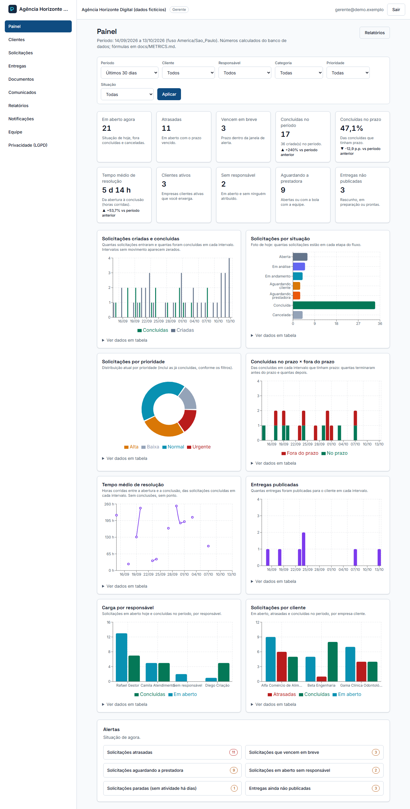

# Portal de Clientes B2B

Um **portal exclusivo para os clientes da sua empresa** e um **painel para a sua equipe**: solicitações com prazo, entregas, documentos privados e comunicados, tudo isolado por empresa. Next.js + Supabase, com RLS em tudo.

**Público:** agências, consultorias, escritórios e prestadores de serviço que atendem empresas clientes de forma recorrente.
**Problema:** pedidos e arquivos espalhados por e-mail e WhatsApp, prazos sem dono e documentos enviados para a pessoa errada.



## O que faz
- **Duas camadas de acesso**: a *prestadora* (administrador, gestor, colaborador, leitor) e a *empresa cliente* (administrador e usuário). Cliente nunca vê outro cliente; colaborador só vê as empresas em que atua.
- **Convites seguros**: link pessoal, para um e-mail, válido por 7 dias e de uso único; o banco guarda só o hash do token.
- **Solicitações** com máquina de estados (aberta, em análise, em andamento, aguardando cliente, aguardando prestadora, concluída, cancelada), prioridade, responsável, **prazo em horas úteis (SLA)** ou combinado, histórico imutável, reabertura pelo cliente dentro de uma janela.
- **Comentários compartilhados × notas internas**: a nota interna nunca chega ao cliente.
- **Documentos privados** por empresa, com pastas, visibilidade (interno × compartilhado), conferência do tipo real do arquivo, **URL assinada de 60 s** e **trilha de acessos** imutável.
- **Entregas**: rascunho → pronta → publicada (o cliente é avisado e os arquivos são liberados) → recebimento confirmado.
- **Comunicados** para todos ou para clientes escolhidos, com agendamento e expiração; **notificações internas**.
- **Painel** (10 indicadores, 8 gráficos, filtros, alertas), o mesmo para a equipe e para o cliente (cada um vê só o que pode); **5 relatórios com CSV auditado**; **white-label** (nome, cores, textos de contato e rodapé).

## Começar em 1 minuto (com Claude Code ou Codex)

1. Abra o **Claude Code** (ou o Codex) numa pasta vazia do seu computador.
2. Copie o link deste repositório e cole no chat com o pedido abaixo:

```text
Instale o Portal de Clientes B2B: https://github.com/pack-25-sistemas-ia/portal-b2b
Clone numa pasta nova e siga o guia .claude/commands/instalar.md. Explique cada passo e me pergunte quando precisar de algo meu.
```

3. Pronto: o agente clona, instala, sobe o banco local e abre o sistema. Depois da primeira vez, dentro da pasta, basta digitar `/instalar` no Claude Code para refazer ou consertar a instalação.

Prefere fazer à mão? Os passos manuais estão logo abaixo.


## Começar
```bash
pnpm install
supabase start && supabase db reset         # banco + Storage locais, com dados fictícios
node scripts/seed-files.mjs                 # envia os arquivos de demonstração (veja docs/DEPLOYMENT.md)
cp .env.example .env.local                  # preencha com as chaves do «supabase status»
pnpm dev
```
Equipe: `gerente@demo.exemplo`. Cliente: `alfa.admin@demo.exemplo`. Senha local única: `DemoLocal#2026`. Detalhes em `docs/DEPLOYMENT.md`.

## Qualidade
`pnpm lint` · `pnpm typecheck` · `pnpm test` (unitários) · `pnpm test:db` (Postgres descartável) · `pnpm test:mutation` (quebra regras críticas de propósito) · `pnpm test:e2e` (Supabase local + app). Estado e evidências: `docs/FEATURES.md`.

## Documentação
`docs/PLANO_IMPLEMENTACAO.md` · `PERMISSIONS.md` (matriz de permissões) · `DOCUMENTS.md` (compartilhamento seguro) · `WORKFLOWS.md` · `METRICS.md` · `DATABASE.md` · `ARCHITECTURE.md` · `DECISIONS.md` · `DEPLOYMENT.md` · `OPEN_SOURCE_AUDIT.md`. Memória para agentes: `MEMORY.md`, `AGENTS.md`, `CLAUDE.md`.

## Segurança em uma frase
Toda leitura passa por RLS; toda escrita sensível passa por função `SECURITY DEFINER` que confere papel, vínculo com a empresa e MFA; o navegador nunca recebe `service_role`; o arquivo só sai do Storage depois de o banco autorizar e registrar o acesso.

## Fora do escopo
ERP, emissão fiscal, cobrança e gateway de pagamento, assinatura certificada, chat omnichannel, WhatsApp automático, CRM comercial, RAG e entrevista de onboarding.

## Privacidade (LGPD)
Dados pessoais tratados: nome, e-mail, e os documentos que a empresa e seus clientes enviarem. Quem implanta o sistema é o controlador dos dados; este software não substitui assessoria jurídica. O acesso a cada documento fica registrado (quem, quando, o quê) e usuários desativados perdem o acesso imediatamente. Não há antivírus no envio de arquivos: veja `docs/DOCUMENTS.md` («Limites conhecidos»).

## Licença
MIT.
